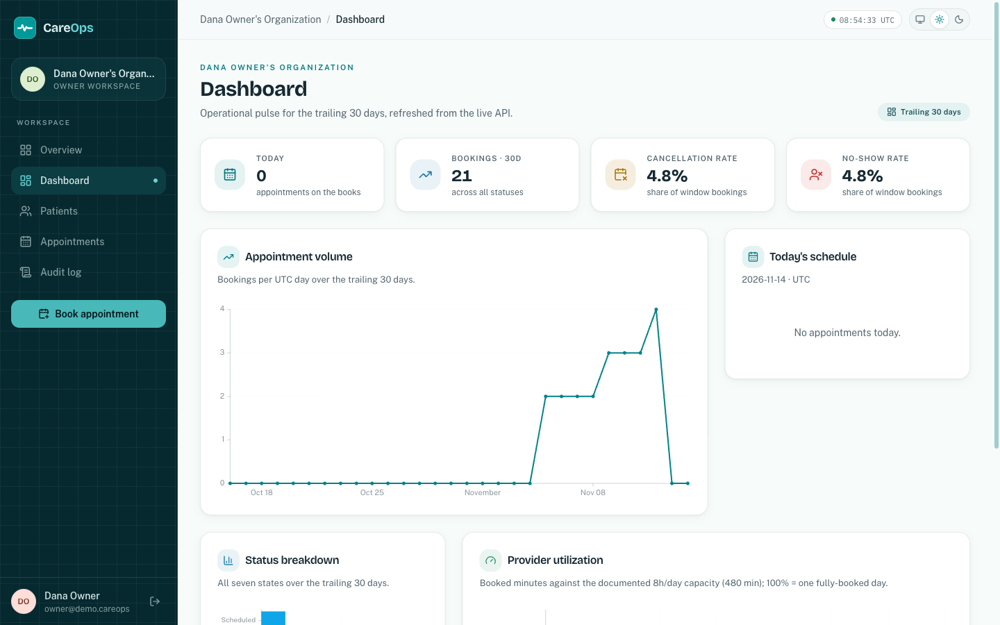
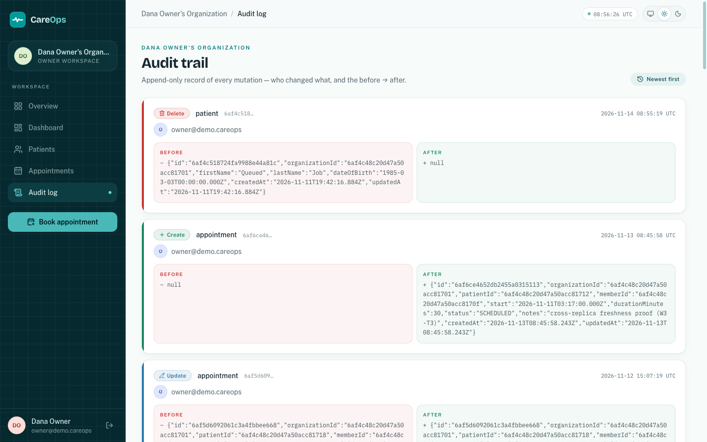
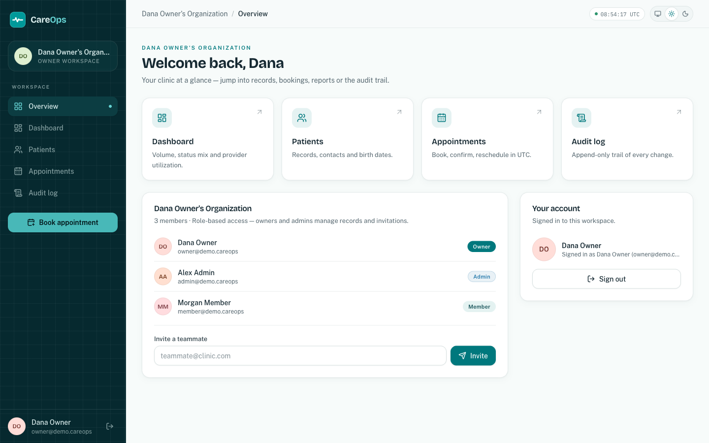
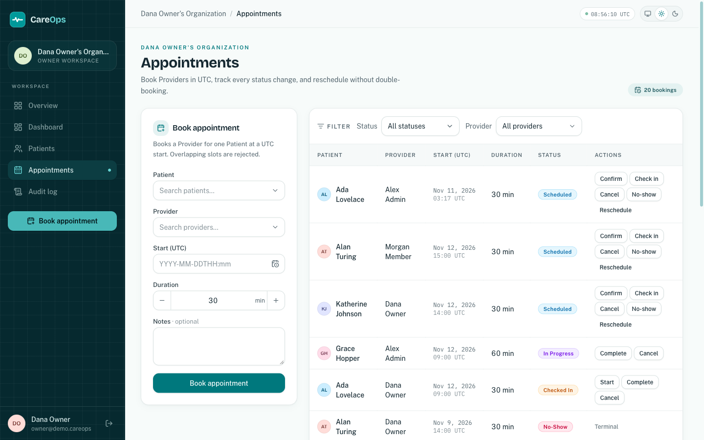
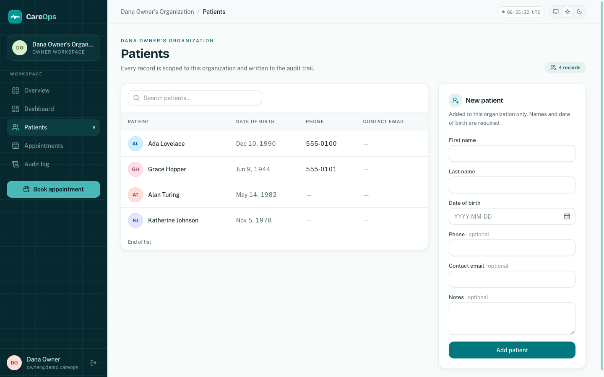
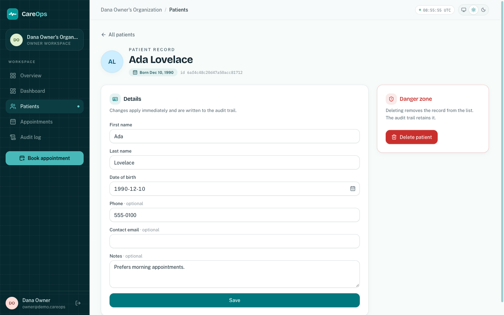
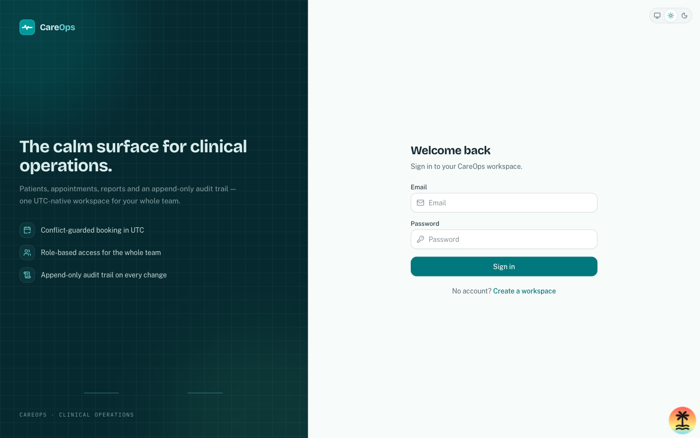
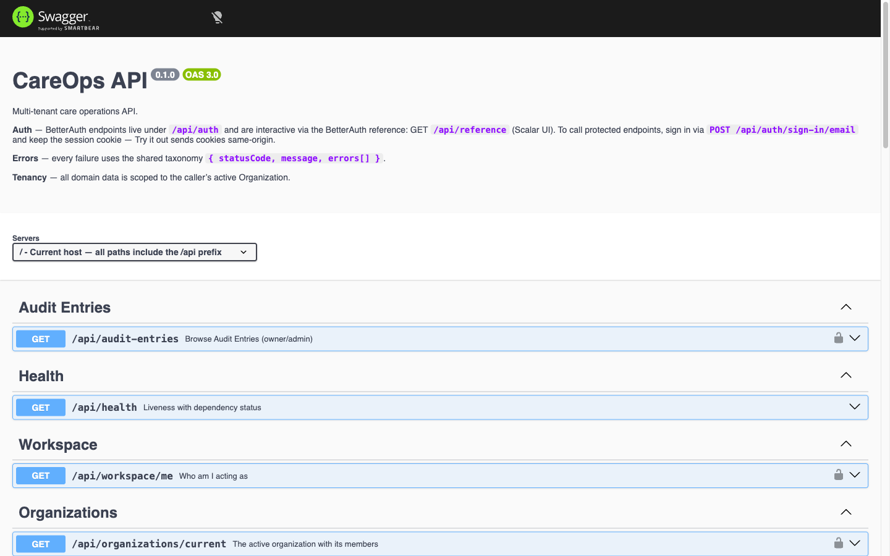

# CareOps

Multi-tenant care operations platform: an organization's staff manage patient
records, appointments are booked in UTC with conflict guards, and every
mutation lands in an append-only audit trail. Built to production shape —
tenant isolation, RBAC, queued side effects, containerized AWS deployment,
and a keyless CI/CD pipeline — with receipts for every performance claim.

[](https://github.com/shakibdshy/careops/actions/workflows/ci.yml)
[](.github/workflows/ci.yml)
[](LICENSE)

> **Not HIPAA-compliant.** CareOps is HIPAA-_minded_ — audit trail on every
> mutation, validated environment, error taxonomy, no real PHI (all seed data
> is fake) — but it makes no compliance claim. Do not store real patient data.

| Dashboard — reports and 30-day pulse                     | Audit trail — every mutation, before → after         |
| -------------------------------------------------------- | ---------------------------------------------------- |
|  |  |

## The product

- **Workspace & RBAC** — sign up an organization, invite teammates, work in
  `owner` / `admin` / `member` roles via BetterAuth's organization plugin;
  role guards per route.
- **Patients** — org-scoped CRUD; every write lands in the audit trail with
  the actor and the before → after snapshot.
- **Appointments** — conflict-guarded booking in UTC (overlapping slots are
  rejected), a full status lifecycle (scheduled → confirmed → checked-in →
  in-progress → complete / cancelled / no-show), rescheduling, and
  self-cancelling 24h reminder jobs.
- **Audit trail** — append-only, browsable; who changed what, when, and the
  atomic before → after diff on updates and deletes.
- **Dashboard & reports** — booking volume, status mix, cancellation and
  no-show rates, provider utilization against documented capacity — served
  through a generation-counter report cache.
- **Notifications** — booking confirmations and reminders delivered through
  Redis + BullMQ with retries and storage-side dedup; Mailpit shows every
  email locally.
- **API-first** — the same contract drives the UI, Swagger, and the tests;
  explore everything at **[/api/docs](http://localhost:3001/api/docs)**.

| Workspace & invites                                      | Booking with conflict guards                                | Patients                                                |
| -------------------------------------------------------- | ----------------------------------------------------------- | ------------------------------------------------------- |
|  |  |  |

| Patient record                                                | Sign-in                                              | API docs (Swagger)                                     |
| ------------------------------------------------------------- | ---------------------------------------------------- | ------------------------------------------------------ |
|  |  |  |

## Stack

| Layer    | Choice                                                                                        |
| -------- | --------------------------------------------------------------------------------------------- |
| Monorepo | Turborepo + bun                                                                               |
| API      | NestJS 12, REST under `/api`                                                                  |
| Web      | TanStack Start (SSR) + Tailwind v4 + shadcn/ui conventions, themed light/dark                 |
| Database | MongoDB 8 (Mongoose for domain, BetterAuth's native adapter for auth)                         |
| Auth     | BetterAuth — email + password, httpOnly cookie sessions, organization plugin (tenancy + RBAC) |
| Queue    | Redis + BullMQ (queued side effects with retries + idempotency keys)                          |
| Mail     | nodemailer SMTP → Mailpit (self-contained sink + web UI, zero external keys)                  |
| Contract | Zod-first: schemas in `packages/shared` drive API validation, Swagger, and web typing         |
| Infra    | AWS CDK — two ECS Fargate tiers behind one ALB, CloudFront edge, ElastiCache, Secrets Manager |
| CI/CD    | GitHub Actions — gates per PR; keyless OIDC deploy on merge to `main`                         |
| Docs     | Swagger UI at **[/api/docs](http://localhost:3001/api/docs)**                                 |

Decisions and their trade-offs live in [docs/adr/](docs/adr) (12 ADRs); domain
language in [GLOSSARY.md](GLOSSARY.md).

## Architecture

```
apps/
  api/    NestJS — auth (BetterAuth mount), organizations, patients,
          appointments (transactional booking), audit, notifications
          (BullMQ + SMTP/Mailpit), health; org-scoped repository base enforces
          tenant isolation at compile time
  web/    TanStack Start SSR — login/signup, workspace (org + invites),
          patients CRUD, appointments, audit browsing; themed light/dark
packages/
  shared/ Zod schemas — single source of truth for API validation,
          Swagger, and web typing (both directions)
infra/    AWS CDK stack — Fargate (API + web SSR) behind one ALB, CloudFront,
          ElastiCache, Secrets Manager; also deploys to the Floci AWS emulator
tools/    Receipt runners — index explain, N+1, cache, k6, lighthouse,
          origin proof; measured outputs in tools/receipts/
docs/     12 ADRs, performance + scaling narratives
```

- **Multi-tenancy**: discriminator key (`organizationId` on every domain
  document), enforced by an org-scoped repository base — an unscoped query
  is a compile error. Proven by an e2e pair (cross-organization reads and
  mutations are 404s). [ADR-0006](docs/adr/0006-tenant-isolation-discriminator-key.md)
- **Transactional booking**: conflict check + create inside a Mongo
  transaction with retry semantics — double-booking is rejected, not
  compensated. [ADR-0010](docs/adr/0010-transactional-conflict-prevention.md)
- **Audit**: append-only `Audit Entry` (who/what/when/before→after) written
  explicitly at the service layer; atomic before-snapshot on updates.
- **Sessions**: DB-backed httpOnly cookies over JWT —
  [ADR-0007](docs/adr/0007-db-backed-cookie-sessions-over-jwt.md).
- **Pagination**: cursor-based everywhere —
  [ADR-0008](docs/adr/0008-cursor-pagination.md).
- **Notifications**: queued delivery (BullMQ) over SMTP to Mailpit. Each event
  claims a durable receipt with a unique `{organizationId, type, refId}` index —
  storage-side dedup that survives BullMQ's pruned job ids. The recipient is
  resolved from the Patient's Contact Email at consume time; no email → a
  `SKIPPED` receipt, never a silent drop. Reminders are delayed jobs at
  start − 24h that cancel themselves when the Appointment is cancelled or moved
  past the reminder time.

## Deployment — all-AWS, in-repo CDK

CareOps deploys as two **stateless** ECS Fargate services — the NestJS API
(`/api/*`) and the TanStack Start SSR web server (`/*`) — behind **one ALB
with no sticky sessions**, fronted by CloudFront for TLS and static-asset
caching. MongoDB Atlas is the only service outside AWS; Redis is ElastiCache;
secrets resolve from Secrets Manager at task runtime, never in the image.
Full story: [ADR-0012](docs/adr/0012-aws-deployment-architecture.md),
runbook: [infra/README.md](infra/README.md).

- **Same-origin by construction** — one domain serves both `/*` and `/api/*`,
  so BetterAuth cookies and CSRF work unchanged (no CORS, no cross-site
  cookies). Proven by a Playwright run against the production containers
  behind an ALB-shaped proxy: `bun tools/prove-origin.mjs` (receipt:
  `tools/receipts/deployed-origin-proof.json`).
- **Auto-scaling, stateless** — target-tracking on CPU and request count
  (bounds 1–4 per tier); any replica serves any request because state lives
  in Mongo/Redis. A cross-replica freshness proof (writes visible from
  whichever replica reads next) backs the no-stickiness claim
  (`tools/receipts/cross-replica-freshness.json`); the k6 replica ramp
  (`tools/k6/ramp.mjs`) measures throughput per replica floor — the
  runbook and its honest pending-live-run table are in
  [docs/scaling.md](docs/scaling.md).
- **Keyless CI/CD** — on push to `main`, the pipeline runs the CI gates,
  builds + pushes both images to ECR (sha-tagged), `cdk deploy`s, and
  smoke-checks the live origin. AWS auth is GitHub OIDC — no static keys;
  one idempotent bootstrap script
  ([`infra/scripts/bootstrap-oidc.mjs`](infra/scripts/bootstrap-oidc.mjs))
  sets up the role. Rollback is a manual re-deploy of a previous sha.
- **Local AWS, zero cost** — the same stack `target=floci` deploys to the
  [Floci](https://floci.io) emulator (ECS/ELBv2/ECR/ElastiCache/Secrets
  Manager/CloudFormation as real Docker containers), so the entire AWS
  wiring is exercised locally before any bill
  ([runbook](infra/README.md#deploy-to-floci-local-no-aws-account)).
- **Template-tested** — `cdk synth` assertions fail the build on plaintext
  secrets, stickiness-on, wrong routing, or wrong health checks
  (`infra/test/careops-stack.test.ts`).

## Performance receipts

"Optimized" as evidence, not prose — every number measured with a reproducible
command ([tools/README.md](tools/README.md)), on a throwaway multi-tenant
dataset (80k appointments), never the demo data:

- **Indexes**: the booking Conflict check drops from a COLLSCAN of 80,000 docs
  to an IXSCAN of 479; a cursor list page examines 21 docs at any depth (vs
  60,021 on a bare `_id` walk).
- **N+1**: provider-utilization is **1** query (server-side `$lookup`) vs **87**
  naive per-row fetches — 3.04× faster, identical rows.
- **Cache**: settled report reads ~1.4–2× faster (controlled miss→hit);
  1.38–1.84× under load (k6, drift-normalized).
- **Lighthouse `/dashboard`** (production build): performance **89** mobile /
  **100** desktop, accessibility 98, 0 ms blocking time, near-zero layout shift.

Before/after tables + commands: [docs/performance.md](docs/performance.md).
How it grows — replicas behind a load balancer, Mongo index catalog / cursor
paging / read preference / shard key, cache layers, BullMQ worker scaling, and
the k6 ramp runbook: [docs/scaling.md](docs/scaling.md).

## Testing

Two seams, no internals: the **HTTP boundary** (supertest against the real
Nest app + `mongodb-memory-server`) and the **browser** (Playwright against
the running stack). Service-level unit tests carry the 80% coverage gate.

```bash
bun run test            # unit + e2e with coverage thresholds
bun run test:e2e:ui     # Playwright (starts its own stack)
bun run lint && bun run typecheck && bun run build
```

CI runs the same lanes on every PR (lint → typecheck → test → build) and
publishes the coverage summary to the job; CDK template assertions run in the
same gate.

## One-command boot

```bash
bun run boot
```

Ensures `apps/api/.env` (from the documented [.env.example](.env.example)),
starts MongoDB + Redis + Mailpit via docker compose (waits for health), seeds a
demo organization with three role accounts and patients, then launches API + web
with hot reload.

- Web: **http://localhost:3000** — Swagger: **http://localhost:3001/api/docs**
- Mailpit (email): **http://localhost:8025** — every notification the stack sends
  (booking confirmations, reminders, patient-created) lands here; SMTP is :1025.
- Demo credentials (password `careops-demo-1`):
  - Owner — `owner@demo.careops`
  - Admin — `admin@demo.careops`
  - Member — `member@demo.careops`

## Development

```bash
bun install
bun run dev      # API :3001 + web :3000 (proxied, same-origin cookies)
bun run seed     # (re)seed the demo organization — idempotent
```

Environment variables are validated with Zod at boot and fail fast naming
the offending variable — see [.env.example](.env.example).

## License

[MIT](LICENSE).
