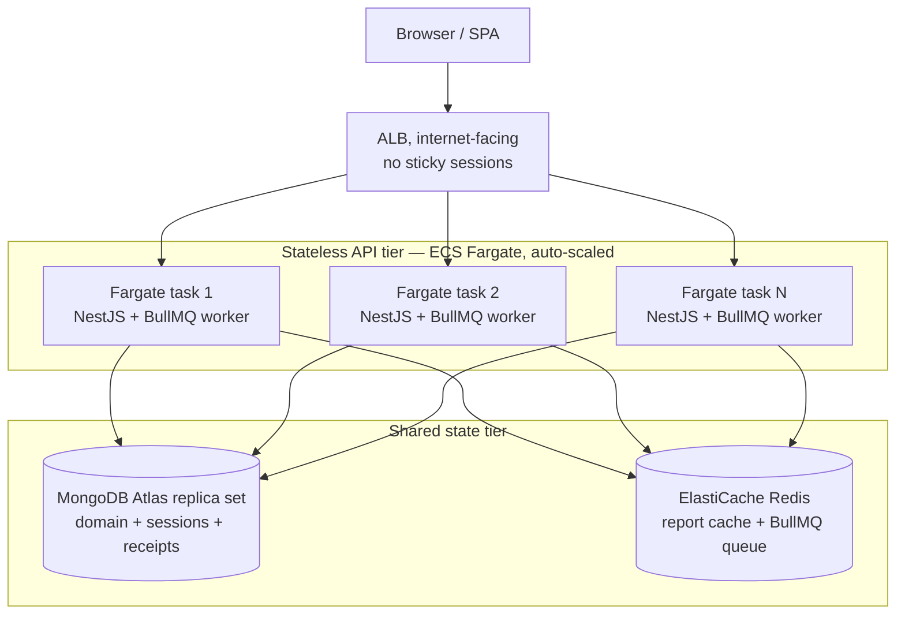

# Scaling CareOps

How the single-replica deployment measured in [performance.md](performance.md)
grows into a multi-replica one, and where the real bottlenecks move. Every
scaling claim is tied to a measured number or an explicit architectural
property; nothing here is a promise about unmeasured load.

## Replicas behind a load balancer

The API tier holds **no in-process state**: sessions live in MongoDB, the report
cache and the job queue live in Redis, and every request re-derives its
Organization from the verified session (ADR-0006). That means any replica can
serve any request — the load balancer needs **no sticky sessions**.

Adding replicas multiplies request throughput and worker concurrency together
(each replica boots its own `NotificationProcessor` worker), until the shared
state tier saturates. The state tier — not the API — is therefore the thing to
scale next, and the sections below are ordered by when each lever becomes worth
pulling.

### Session-store scalability, honestly (ADR-0007)

The usual scaling checklist reaches for "stateless JWT + refresh rotation." We
deliberately keep BetterAuth's DB-backed httpOnly cookie sessions, and the
honest argument is about _what_ statelessness buys: horizontal scaling needs the
absence of **in-process / sticky** state, not the absence of a session store.
CareOps sessions are a **tiny, indexed, horizontally-shared collection** — one
indexed Mongo lookup per request, served by any replica. "Add replicas" scales
identically to JWT, while keeping server-side revocation (a JWT cannot be
un-issued before expiry without a denylist, which reintroduces shared state
anyway). The session collection is small and point-read by an indexed key, so it
is not the bottleneck; it rides the same Mongo scaling levers as the domain
data. JWT remains the recorded path if mobile or third-party token clients
arrive (ADR-0007), not a scaling fix we need today.

## MongoDB

### Compound-index catalog, per query shape

Every index leads with `organizationId` (ADR-0006), so a query never scans
another tenant's documents and the planner can target a single shard (§ shard
key). The catalog, with the measured effect from
[`index-explain.json`](../tools/receipts/index-explain.json):

| Query shape                                          | Index                          | Serves                                      | Measured effect                        |
| ---------------------------------------------------- | ------------------------------ | ------------------------------------------- | -------------------------------------- |
| `{org, memberId, start}` + status/overlap predicates | `org_member_start`             | booking Conflict check (ADR-0010)           | COLLSCAN 80,000 docs → IXSCAN 479 docs |
| `{org, _id > cursor}` sort `_id`                     | `org_id_cursor`                | every cursor list (ADR-0008)                | `_id` walk 60,021 docs → 21 docs       |
| `{org, start range}`                                 | `org_start`                    | daily-volume, status-breakdown, `/today`    | org-scoped range scan                  |
| `{org, status, start range}`                         | `org_status_start`             | provider-utilization (excludes freed slots) | status-prefixed range scan             |
| `{org, _id}` / `{org, _id desc}`                     | patient / audit cursor indexes | patients + audit lists                      | O(page) cursor                         |
| `{org, type, refId}` **unique**                      | notification dedup             | storage-side delivery dedup                 | survives job-id pruning                |
| `{org, memberId}` **unique**                         | provider schedule              | one schedule per Provider                   | uniqueness guard                       |

Adding a query shape means adding an index (ADR-0006 consequence); the catalog
above is the contract between query shapes and indexes.

### Cursor pagination (ADR-0008)

`skip(n)` walks and discards `n` documents server-side, so latency grows
linearly with page depth. A cursor range scan (`_id > cursor` on the org-leading
compound index) is **O(pageSize) at any depth**. The receipt makes it concrete:
a 21-row page examines **21 documents** with `org_id_cursor` versus **60,021**
when the planner falls back to the bare `_id` index and walks past other
tenants' newer ids. Under load the deep pages are no slower than the first
(p95 24.56ms deep vs 35.42ms first, [`k6-appointments-list.json`](../tools/receipts/k6-appointments-list.json)).
Cursor paging also can't skip or duplicate rows under concurrent inserts, which
offset paging does. The cost: no arbitrary "page 7 of 40" jumps — the web app
uses load-more.

### Read preference

Today every read goes to the **primary** (driver default). That is the right
starting point: the report cache already absorbs most aggregation read load,
and `/today` — the latency-sensitive "what is happening now" view — must not
read replication-lagged data. The lever, when read volume outgrows a single
primary, is `secondaryPreferred` for the **cached trailing-window aggregations**
(daily-volume, status-breakdown, provider-utilization): they tolerate bounded
staleness already (cache TTL), so replication lag stacks acceptably. Keep
`/today`, the Conflict check, and all writes on the primary. This is a
discussion of the trade-off, not a configured behavior — at the measured scale
the primary is not the bottleneck.

### Shard key: hashed `organizationId`

When one replica set can no longer hold the working set, shard on
**`{ organizationId: "hashed" }`**. Hashing spreads tenants evenly across shards
and avoids the monotonic hotspot a ranged `_id`/time key would create (all new
writes landing on one shard). Because **every query and every index leads with
`organizationId`**, an org-scoped query is _targeted_ to the shard(s) holding
that org — no scatter-gather — and a within-org `start` range stays inside that
org's chunks. The trade-offs, stated plainly: a hashed key gives no cross-org
range locality (fine — we never query across orgs), and a single very large
Organization still lives on one shard (hashing the org id does not split one
org); splitting a whale tenant would need a compound shard key such as
`{organizationId, _id}`, a future consideration rather than a present need.

## Cache layers

The report cache (ADR-0011) is the first scaling lever because it removes whole
aggregations from the Mongo path:

- **What is cached:** daily-volume and provider-utilization, cache-aside in
  Redis under `reports:{org}:{generation}:{report}:{days}`. **What stays live:**
  status-breakdown and `/today`, so the "now" view is never stale.
- **Invalidation:** every Appointment write bumps `reports:gen:{org}` with one
  `INCR` post-commit; a new generation is a new key, so invalidation is O(1) and
  instant with no key scans. A 300s TTL is a backstop, not the primary
  invalidator (bounded staleness ≤300s on a missed bump or Redis outage).
- **Measured effect:** ~1.4–2× faster settled reads
  ([`cache-miss-hit.json`](../tools/receipts/cache-miss-hit.json)); under load the
  normalized cold/warm p95 ratio is 1.38× / 1.84×
  ([`k6-summary.json`](../tools/receipts/k6-summary.json)).
- **Scaling Redis:** the generation counter is a single-writer-per-org key
  (cheap `INCR`), while cache _reads_ are the volume — they scale with Redis
  read replicas or a cluster. Tenant isolation is structural: the org id is in
  both the counter and entry keys, so one tenant's invalidation never touches
  another's entries. Redis is a boundary: every cache read/write degrades to a
  fresh compute on error, so a Redis outage slows reports but never fails a
  request or a committed booking.

## Queue and worker scaling (BullMQ)

Notification delivery is queued side-effect work, decoupled from the request
path:

- **Retry:** `attempts: 5` with exponential backoff (500ms base) for thrown
  errors / crashes; `removeOnComplete: 100`, `removeOnFail: 500` bound the
  finished-job keyspace so Redis memory doesn't grow without limit.
- **Transport failures are outcomes, not retries:** the processor catches an
  SMTP error and records a `FAILED` receipt, completing the job — a bad mail
  server cannot cause an infinite retry loop. A missing Contact Email records
  `SKIPPED`, never a silent drop.
- **Dedup is storage-side:** each job claims a durable receipt guarded by the
  unique `{organizationId, type, refId}` index. BullMQ's own jobId dedup dies
  when `removeOnComplete` prunes the id; the Mongo unique index survives it, so
  a redelivered or duplicated job is `DEDUPED` rather than double-sent.
- **Scaling workers:** each API replica boots one worker at BullMQ's default
  concurrency (1 job at a time). Throughput therefore scales two ways: **add
  replicas** (more workers, same shared queue) or **raise per-worker
  concurrency**. Because dedup and receipts are in Mongo and the queue is in
  Redis, workers are stateless and can be added or restarted freely; delayed
  reminder jobs cancel themselves when the Appointment is cancelled or moved,
  so scaling out never resurrects a stale reminder.

## Capacity table (fed by the k6 numbers)

Measured operating points, **one API replica + one Mongo + one Redis** on a dev
laptop, 10 VUs / 30s ([`k6-summary.json`](../tools/receipts/k6-summary.json),
[`k6-appointments-list.json`](../tools/receipts/k6-appointments-list.json)).
These are observations, not SLAs.

| Workload                                    | VUs |     Throughput (measured) | p95 (measured) | Errors |
| ------------------------------------------- | --: | ------------------------: | -------------: | -----: |
| Dashboard, warm cache (4 report reads/iter) |  10 | ~42 iter/s (~167 reads/s) |       ≤18.4 ms |      0 |
| Dashboard, cache invalidated continuously   |  10 | ~40 iter/s (~160 reads/s) |       ≤24.9 ms |      0 |
| Appointments list (3 cursor pages/iter)     |  10 | ~38 iter/s (~114 reads/s) |       ≤35.4 ms |      0 |

How this grows, with the assumption stated: because the API tier is stateless,
request throughput scales **approximately linearly with replica count** until
the shared state tier saturates — so the next bottleneck is Mongo (aggregation
CPU + working set) and Redis (cache reads), addressed by the levers above
(report cache first, then read replicas / `secondaryPreferred`, then sharding).
The W3-T3 sections below replace that extrapolation with what is now measured
on the deployed topology — and say plainly what is still pending a live run.

## Multi-replica on AWS: the deployed topology (ADR-0012, W3-T3)

The CDK stack ([`infra/`](../infra/README.md)) deploys the diagram above as
real infrastructure: an internet-facing **ALB** (stickiness disabled, asserted
in the template tests) routing `/api/*` to an **ECS Fargate** service — each
replica 0.5 vCPU / 1 GB in private subnets — reading MongoDB **Atlas** via a
runtime secret and **ElastiCache** Redis for the report cache and job queue.

The service auto-scales on two **target-tracking** policies inside
`minCapacity`/`maxCapacity` bounds (default 1–4, both deploy-time
configurable):

| Policy            | Signal                       | Target         | Out/In cooldown |
| ----------------- | ---------------------------- | -------------- | --------------- |
| `ScaleOnCpu`      | ECS avg CPU utilization      | 60%            | 60s / 180s      |
| `ScaleOnRequests` | ALB request count per target | 500 req/target | 60s / 180s      |

CPU catches the aggregation-heavy regime (0.5 vCPU is the first resource
exhausted under fan-out reads); the request-count signal covers the I/O-bound
regime CPU misses, where cache hits keep CPU low while pressure keeps rising.

### Cross-replica freshness: measured (W3-T3)

The property horizontal scaling depends on most — that a booking committed
through one replica is already visible in a report read served by another — is
proven, not assumed
([`cross-replica-freshness.json`](../tools/receipts/cross-replica-freshness.json)):
two replicas of the same image are booted against one shared Mongo + Redis,
the session cookie signed on replica A is accepted by replica B (shared
session store, ADR-0007), a booking is committed through A, and B's **next**
daily-volume read already includes it. The mechanism is the ADR-0011
generation counter in the shared cache: A's post-commit `INCR` advanced the
org generation 53 → 54, so B's cached read recomputed under the new key —
booked day 2 → 3 appointments, trailing-30d total 20 → 21. No replica-local
cache can hide a booking from the other replicas. Reproduce with
`bun tools/prove-replica-freshness.mjs`.

### The replica ramp: 1 → 2 → 4 (runbook)

Aggregate throughput is measured per stage with the W2-T9 dashboard scenario
(4 report reads/iteration, warm cache) against the ALB, at a pinned replica
floor: each stage redeploys with `-c minCapacity=N`, so auto-scaling scale-in
holds exactly N replicas for the measurement. The runner
(`bun tools/k6/ramp.mjs`) refuses to record a stage until ECS reports at
least N tasks RUNNING — the receipt states "N replicas, **measured**", never
"configured" — then `--report` fails unless per-stage throughput rose and no
request failed.

| Stage (minCapacity) | Replicas measured | reads/s | p95 | Failures |
| ------------------- | ----------------- | ------- | --- | -------- |
| 1                   | — pending AWS run | —       | —   | —        |
| 2                   | — pending AWS run | —       | —   | —        |
| 4                   | — pending AWS run | —       | —   | —        |

This table is the one claim **not yet backed by a live AWS run**: it needs a
deployed stack (AWS credentials on the operator side) and is filled by
running the three `ramp.mjs` stages above with `BASE_URL` pointed at the
ALB's DNS output. Every stage of the tooling — the bounded auto-scaling
policies, the running-count gate, the receipt, the rising-throughput verdict —
is implemented and template-tested; the run replaces the empty table (and this
sentence) with numbers and the measured ceiling + bottleneck, superseding the
laptop-rig extrapolation above.
